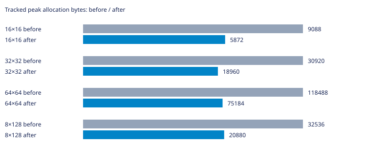
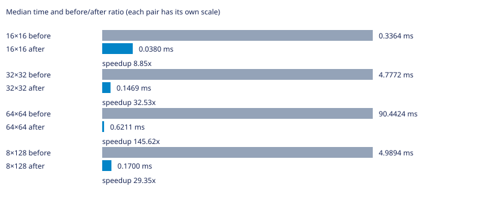

# Labirit

Генератор лабиринтов на C для Linux. Поддерживает алгоритмы Прима, DFS, растущего дерева, Уотсона, двоичного дерева и рекурсивного разделения.

Нужны GNU Make и компилятор C с поддержкой C23.

## Запуск

```bash
make
```

Команда собирает программу и выводит лабиринт 10×10. Чтобы выбрать алгоритм, размер и seed, сначала соберите программу, затем запустите её с аргументами:

```bash
make compile
./main dfs 20 12 42
```

Формат: `./main [алгоритм] [столбцы] [строки] [seed]`. Если seed не задан, он выбирается случайно. Для списка аргументов используйте `./main --help`.

## Другие команды

```bash
make benchmark  # запустить бенчмарки; JSON-файлы результатов перезаписываются
make test       # собрать и запустить тесты
make clean      # удалить собранные программы
```

## УНИКАЛЬНАЯ ИНФОРМАЦИЯ О ВЕТКЕ

### Суть проблемы и оптимизации

Линейный поиск по списку посещённых заменён байтовым массивом: проверка O(1), один буфер вместо узла на клетку. Стены и поток rand совпали с исходной реализацией на измеренных сетках. В CSV также сохранён эксперимент bitset: он экономит память, но требует маскирования; для основного варианта выбран простой байтовый доступ. Исходная ошибка инициализации Прима на вырожденных сетках пока сохраняется и исправляется следующим изменением; проверки 1×N и N×1 для этого сравнения исключены.

### Статистика

База — родительский main перед этой оптимизацией. GCC 16.2.1, `-std=c23 -O2 -D_GNU_SOURCE`, Linux x86_64. PRNG и LD_PRELOAD не изменялись; LD_PRELOAD не использовался. Измерения последовательные, один процесс на случай, CLOCK_MONOTONIC. Перед измерениями выполнен прогрев; seeds 1, 42, 202, по три повтора. Время — медиана девяти запусков без инструментирования (`LABIRIT_METRICS_ENABLED=0`); память — максимальный пик учтённых выделений отдельного запуска с метриками. Это не RSS и не объём с учётом служебных данных аллокатора. В CSV сохранены исходные измерения; время в миллисекундах. Инициализация и генерация измерены раздельно.

| Сетка | Было, мс | Стало, мс | Было/стало | Пик до, байт | Пик после, байт |
|---|---:|---:|---:|---:|---:|
| 16×16 | 0.3364 | 0.0380 | 8.85× | 9088 | 5872 |
| 32×32 | 4.7772 | 0.1469 | 32.53× | 30920 | 18960 |
| 64×64 | 90.4424 | 0.6211 | 145.62× | 118488 | 75184 |
| 8×128 | 4.9894 | 0.1700 | 29.35× | 32536 | 20880 |





Исходные результаты: [CSV](tests/prim-visited.csv). Проверены связность, N−1 рёбер, симметрия стен и закрытый периметр; после освобождения учтённая память равна нулю. Временные измерительные программы и исполняемые файлы в коммит не включены. Малые различия времени могут быть шумом; ускорение нельзя переносить на другие машины без повторных замеров.
