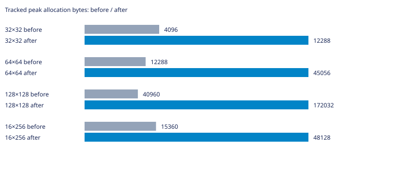
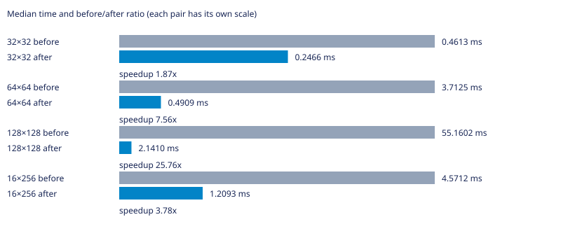

# Labirit

Генератор лабиринтов на C для Linux. Поддерживает алгоритмы Прима, DFS, растущего дерева, Уотсона, двоичного дерева и рекурсивного разделения.

Нужны GNU Make и компилятор C с поддержкой C23.

## Запуск

```bash
make
```

Команда собирает программу и выводит лабиринт 10×10. Чтобы выбрать алгоритм, размер и seed, сначала соберите программу, затем запустите её с аргументами:

```bash
make compile
./main dfs 20 12 42
```

Формат: `./main [алгоритм] [столбцы] [строки] [seed]`. Если seed не задан, он выбирается случайно. Для списка аргументов используйте `./main --help`.

## Другие команды

```bash
make benchmark  # запустить бенчмарки; JSON-файлы результатов перезаписываются
make test       # собрать и запустить тесты
make clean      # удалить собранные программы
```

## УНИКАЛЬНАЯ ИНФОРМАЦИЯ О ВЕТКЕ

### Суть проблемы и оптимизации

Повторные сканирования сетки заменены плотным массивом непосещённых индексов и обратными позициями. Выбор старта и удаление клетки занимают O(1); клетка удаляется при первом присоединении к дереву. Случайные блуждания остаются зависимыми от W, линейная сложность всей генерации не заявляется. Перестановка массива меняет соответствие rand конкретной клетке, поэтому стены и длительность блужданий меняются. Выбор использует прежнее rand()%remaining, без исправления modulo-смещения. Ускорение оплачено двумя массивами по N int: на 128×128 учтённый пик вырос с 40960 до 172032 байт. Это осознанный обмен памяти на скорость; на памяти-ограниченных входах его нужно учитывать.

### Статистика

База — родительский main перед этой оптимизацией. GCC 16.2.1, `-std=c23 -O2 -D_GNU_SOURCE`, Linux x86_64. PRNG и LD_PRELOAD не изменялись; LD_PRELOAD не использовался. Измерения последовательные, один процесс на случай, CLOCK_MONOTONIC. Перед измерениями выполнен прогрев; seeds 1, 42, 202, по три повтора. Время — медиана девяти запусков без инструментирования (`LABIRIT_METRICS_ENABLED=0`); память — максимальный пик учтённых выделений отдельного запуска с метриками. Это не RSS и не объём с учётом служебных данных аллокатора. В CSV сохранены исходные измерения; время в миллисекундах. Инициализация и генерация измерены раздельно.

| Сетка | Было, мс | Стало, мс | Было/стало | Пик до, байт | Пик после, байт |
|---|---:|---:|---:|---:|---:|
| 32×32 | 0.4613 | 0.2466 | 1.87× | 4096 | 12288 |
| 64×64 | 3.7125 | 0.4909 | 7.56× | 12288 | 45056 |
| 128×128 | 55.1602 | 2.1410 | 25.76× | 40960 | 172032 |
| 16×256 | 4.5712 | 1.2093 | 3.78× | 15360 | 48128 |





Исходные результаты: [CSV](tests/watson-unvisited.csv). Проверены связность, N−1 рёбер, симметрия стен и закрытый периметр; после освобождения учтённая память равна нулю. Временные измерительные программы и исполняемые файлы в коммит не включены. Малые различия времени могут быть шумом; ускорение нельзя переносить на другие машины без повторных замеров.
