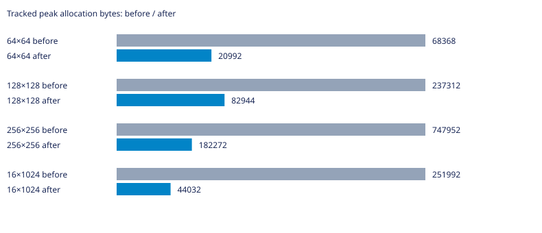
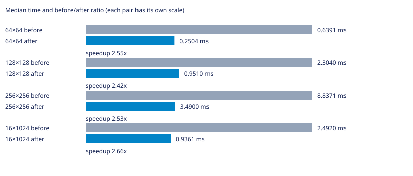

# Labirit

Генератор лабиринтов на C для Linux. Поддерживает алгоритмы Прима, DFS, растущего дерева, Уотсона, двоичного дерева и рекурсивного разделения.

Нужны GNU Make и компилятор C с поддержкой C23.

## Запуск

```bash
make
```

Команда собирает программу и выводит лабиринт 10×10. Чтобы выбрать алгоритм, размер и seed, сначала соберите программу, затем запустите её с аргументами:

```bash
make compile
./main dfs 20 12 42
```

Формат: `./main [алгоритм] [столбцы] [строки] [seed]`. Если seed не задан, он выбирается случайно. Для списка аргументов используйте `./main --help`.

## Другие команды

```bash
make benchmark  # запустить бенчмарки; JSON-файлы результатов перезаписываются
make test       # собрать и запустить тесты
make clean      # удалить собранные программы
```

## УНИКАЛЬНАЯ ИНФОРМАЦИЯ О ВЕТКЕ

### Суть проблемы и оптимизации

Отдельные узлы связанного списка заменены геометрически растущим массивом рёбер. Извлечение заменяет выбранное ребро последним и занимает O(1); добавление амортизированно O(1). Пик учитывает возможный перенос realloc. На выбранных входах генерация ускорилась в 2,4–2,7 раза. Политика изменилась: вместо геометрического предпочтения головы списка используется rand()%count по всем активным рёбрам. Поэтому это сравнение двух политик Прима, а не только замена контейнера с неизменными случайными решениями; modulo-ограничения существующего rand сохранены. Все результаты остаются корректными деревьями, но распределение и внешний вид меняются.

### Статистика

База — родительский main перед этой оптимизацией. GCC 16.2.1, `-std=c23 -O2 -D_GNU_SOURCE`, Linux x86_64. PRNG и LD_PRELOAD не изменялись; LD_PRELOAD не использовался. Измерения последовательные, один процесс на случай, CLOCK_MONOTONIC. Перед измерениями выполнен прогрев; seeds 1, 42, 202, по три повтора. Время — медиана девяти запусков без инструментирования (`LABIRIT_METRICS_ENABLED=0`); память — максимальный пик учтённых выделений отдельного запуска с метриками. Это не RSS и не объём с учётом служебных данных аллокатора. В CSV сохранены исходные измерения; время в миллисекундах. Инициализация и генерация измерены раздельно.

| Сетка | Было, мс | Стало, мс | Было/стало | Пик до, байт | Пик после, байт |
|---|---:|---:|---:|---:|---:|
| 64×64 | 0.6391 | 0.2504 | 2.55× | 68368 | 20992 |
| 128×128 | 2.3040 | 0.9510 | 2.42× | 237312 | 82944 |
| 256×256 | 8.8371 | 3.4900 | 2.53× | 747952 | 182272 |
| 16×1024 | 2.4920 | 0.9361 | 2.66× | 251992 | 44032 |





Исходные результаты: [CSV](tests/prim-frontier.csv). Проверены связность, N−1 рёбер, симметрия стен и закрытый периметр; после освобождения учтённая память равна нулю. Временные измерительные программы и исполняемые файлы в коммит не включены. Малые различия времени могут быть шумом; ускорение нельзя переносить на другие машины без повторных замеров.
