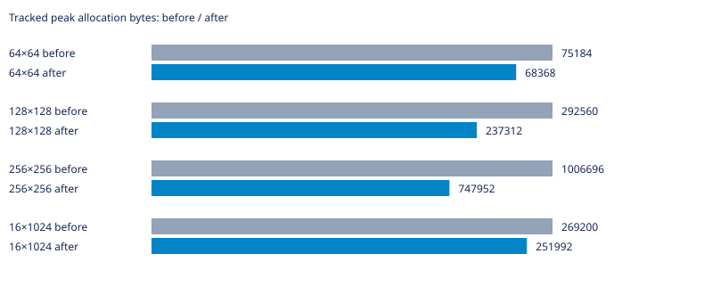
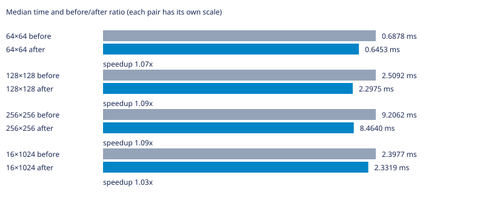

# Labirit

Генератор лабиринтов на C для Linux. Поддерживает алгоритмы Прима, DFS, растущего дерева, Уотсона, двоичного дерева и рекурсивного разделения.

Нужны GNU Make и компилятор C с поддержкой C23.

## Запуск

```bash
make
```

Команда собирает программу и выводит лабиринт 10×10. Чтобы выбрать алгоритм, размер и seed, сначала соберите программу, затем запустите её с аргументами:

```bash
make compile
./main dfs 20 12 42
```

Формат: `./main [алгоритм] [столбцы] [строки] [seed]`. Если seed не задан, он выбирается случайно. Для списка аргументов используйте `./main --help`.

## Другие команды

```bash
make benchmark  # запустить бенчмарки; JSON-файлы результатов перезаписываются
make test       # собрать и запустить тесты
make clean      # удалить собранные программы
```

## УНИКАЛЬНАЯ ИНФОРМАЦИЯ О ВЕТКЕ

### Суть проблемы и оптимизации

Выбранное ребро к уже посещённой цели теперь сразу отбрасывается. Соседи добавляются лишь при первом посещении, поэтому на решётке добавляется O(N) рёбер. Начальные рёбра проверяются по размерам, устранён выход за границы на 1×N и N×1. Отказ выделения приводит к освобождению границы и посещений. Поток случайных вызовов меняется: удалены лишние рёбра, поэтому совпадение стен с базой не обещается. На всех измеренных случаях генераторы дают связное дерево с закрытым периметром; распределение конкретных деревьев этой серией статистически не доказано.

### Статистика

База — родительский main перед этой оптимизацией. GCC 16.2.1, `-std=c23 -O2 -D_GNU_SOURCE`, Linux x86_64. PRNG и LD_PRELOAD не изменялись; LD_PRELOAD не использовался. Измерения последовательные, один процесс на случай, CLOCK_MONOTONIC. Перед измерениями выполнен прогрев; seeds 1, 42, 202, по три повтора. Время — медиана девяти запусков без инструментирования (`LABIRIT_METRICS_ENABLED=0`); память — максимальный пик учтённых выделений отдельного запуска с метриками. Это не RSS и не объём с учётом служебных данных аллокатора. В CSV сохранены исходные измерения; время в миллисекундах. Инициализация и генерация измерены раздельно.

| Сетка | Было, мс | Стало, мс | Было/стало | Пик до, байт | Пик после, байт |
|---|---:|---:|---:|---:|---:|
| 64×64 | 0.6878 | 0.6453 | 1.07× | 75184 | 68368 |
| 128×128 | 2.5092 | 2.2975 | 1.09× | 292560 | 237312 |
| 256×256 | 9.2062 | 8.4640 | 1.09× | 1006696 | 747952 |
| 16×1024 | 2.3977 | 2.3319 | 1.03× | 269200 | 251992 |





Исходные результаты: [CSV](tests/prim-expansion.csv). Проверены связность, N−1 рёбер, симметрия стен и закрытый периметр; после освобождения учтённая память равна нулю. Временные измерительные программы и исполняемые файлы в коммит не включены. Малые различия времени могут быть шумом; ускорение нельзя переносить на другие машины без повторных замеров.
