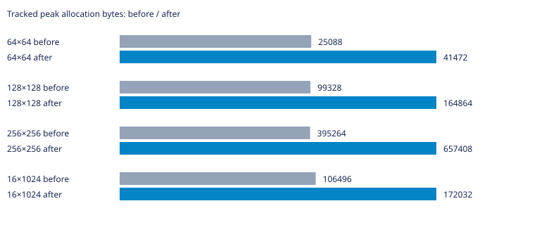
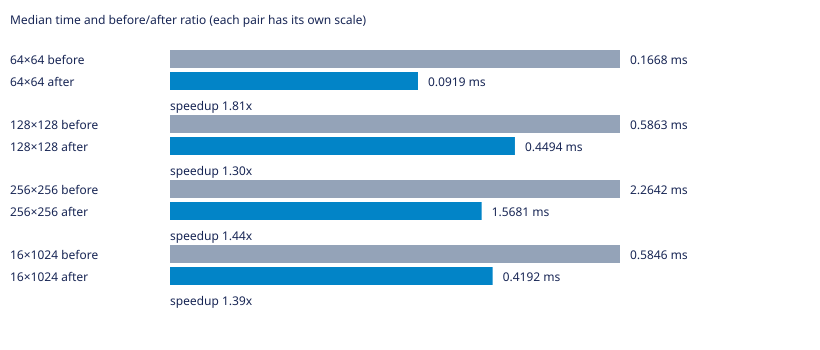

# Labirit

Генератор лабиринтов на C для Linux. Поддерживает алгоритмы Прима, DFS, растущего дерева, Уотсона, двоичного дерева и рекурсивного разделения.

Нужны GNU Make и компилятор C с поддержкой C23.

## Запуск

```bash
make
```

Команда собирает программу и выводит лабиринт 10×10. Чтобы выбрать алгоритм, размер и seed, сначала соберите программу, затем запустите её с аргументами:

```bash
make compile
./main dfs 20 12 42
```

Формат: `./main [алгоритм] [столбцы] [строки] [seed]`. Если seed не задан, он выбирается случайно. Для списка аргументов используйте `./main --help`.

## Другие команды

```bash
make benchmark  # запустить бенчмарки; JSON-файлы результатов перезаписываются
make test       # собрать и запустить тесты
make clean      # удалить собранные программы
```

## УНИКАЛЬНАЯ ИНФОРМАЦИЯ О ВЕТКЕ

### Суть проблемы и оптимизации

Повторное вычисление координат и обход соседей при возврате заменены кадрами с x/y и маской доступных направлений на клетку. При посещении клетки сразу удаляется направление к ней из масок её соседей. Выбор через маленькую таблицу сохраняет порядок top/right/bottom/left, число случайных выборов и итоговые стены: контрольные хеши совпали с базой на всех измеренных входах. Стек занимает 8N вместо 4N байт; массив масок заменяет visited, поэтому суммарный рабочий буфер вырос с 5N до 9N байт. Первый эксперимент с большим кадром и повторной фильтрацией соседей ускорения не дал и в итоговый код не включён. Счётчик шагов теперь отражает обслуживание масок вместо прежних повторных проверок соседей.

### Статистика

База — родительский main перед этой оптимизацией. GCC 16.2.1, `-std=c23 -O2 -D_GNU_SOURCE`, Linux x86_64. PRNG и LD_PRELOAD не изменялись; LD_PRELOAD не использовался. Измерения последовательные, один процесс на случай, CLOCK_MONOTONIC. Перед измерениями выполнен прогрев; seeds 1, 42, 202, по три повтора. Время — медиана девяти запусков без инструментирования (`LABIRIT_METRICS_ENABLED=0`); память — максимальный пик учтённых выделений отдельного запуска с метриками. Это не RSS и не объём с учётом служебных данных аллокатора. В CSV сохранены исходные измерения; время в миллисекундах. Инициализация и генерация измерены раздельно.

| Сетка | Было, мс | Стало, мс | Было/стало | Пик до, байт | Пик после, байт |
|---|---:|---:|---:|---:|---:|
| 64×64 | 0.1668 | 0.0919 | 1.81× | 25088 | 41472 |
| 128×128 | 0.5863 | 0.4494 | 1.30× | 99328 | 164864 |
| 256×256 | 2.2642 | 1.5681 | 1.44× | 395264 | 657408 |
| 16×1024 | 0.5846 | 0.4192 | 1.39× | 106496 | 172032 |





Исходные результаты: [CSV](tests/dfs-frames.csv). Проверены связность, N−1 рёбер, симметрия стен и закрытый периметр; после освобождения учтённая память равна нулю. Временные измерительные программы и исполняемые файлы в коммит не включены. Малые различия времени могут быть шумом; ускорение нельзя переносить на другие машины без повторных замеров.
