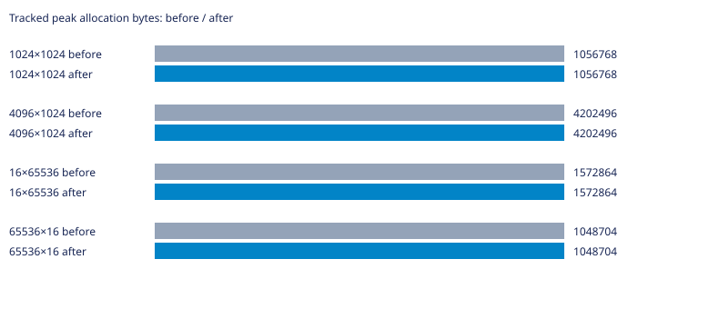
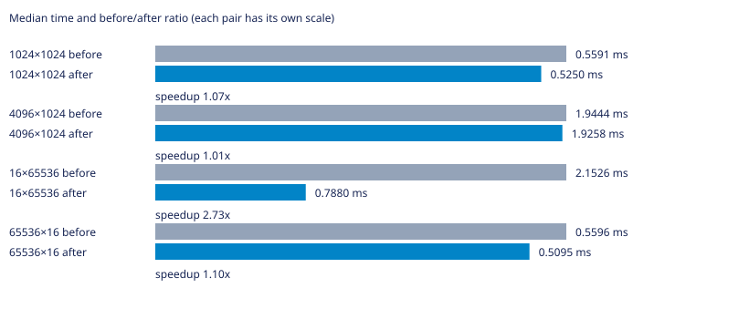

# Labirit

Генератор лабиринтов на C для Linux. Поддерживает алгоритмы Прима, DFS, растущего дерева, Уотсона, двоичного дерева и рекурсивного разделения.

Нужны GNU Make и компилятор C с поддержкой C23.

## Запуск

```bash
make
```

Команда собирает программу и выводит лабиринт 10×10. Чтобы выбрать алгоритм, размер и seed, сначала соберите программу, затем запустите её с аргументами:

```bash
make compile
./main dfs 20 12 42
```

Формат: `./main [алгоритм] [столбцы] [строки] [seed]`. Если seed не задан, он выбирается случайно. Для списка аргументов используйте `./main --help`.

## Другие команды

```bash
make benchmark  # запустить бенчмарки; JSON-файлы результатов перезаписываются
make test       # собрать и запустить тесты
make clean      # удалить собранные программы
```

## УНИКАЛЬНАЯ ИНФОРМАЦИЯ О ВЕТКЕ

### Суть проблемы и оптимизации

Указатели строк и клетки теперь принадлежат одному блоку, освобождаемому clear_table. Доступ data[y][x] сохранён. Размеры проверяются до умножений; пустые и не представимые индексами сетки возвращают data=NULL. Вместо rows+1 выделений выполняется одно. Сумма запрошенных байтов не изменилась; накладные расходы аллокатора в график памяти не включены. Самый заметный выигрыш на узкой высокой сетке 16×65536: инициализация ускорилась примерно в 2,7 раза. На 4096×1024 разница близка к шуму. Таблица показывает время инициализации, а не генерации. Стены начальной сетки совпадают с базой. Штатный make test уже в исходном репозитории не собирается из-за отсутствующих growing_tree_reference.h и distance_metrics_reference.h; использованы отдельные локальные проверки, без добавления тестовых исходников в репозиторий.

### Статистика

База — родительский main перед этой оптимизацией. GCC 16.2.1, `-std=c23 -O2 -D_GNU_SOURCE`, Linux x86_64. PRNG и LD_PRELOAD не изменялись; LD_PRELOAD не использовался. Измерения последовательные, один процесс на случай, CLOCK_MONOTONIC. Перед измерениями выполнен прогрев; seeds 1, 42, 202, по три повтора. Время — медиана девяти запусков без инструментирования (`LABIRIT_METRICS_ENABLED=0`); память — максимальный пик учтённых выделений отдельного запуска с метриками. Это не RSS и не объём с учётом служебных данных аллокатора. В CSV сохранены исходные измерения; время в миллисекундах. Инициализация и генерация измерены раздельно.

| Сетка | Было, мс | Стало, мс | Было/стало | Пик до, байт | Пик после, байт |
|---|---:|---:|---:|---:|---:|
| 1024×1024 | 0.5591 | 0.5250 | 1.07× | 1056768 | 1056768 |
| 4096×1024 | 1.9444 | 1.9258 | 1.01× | 4202496 | 4202496 |
| 16×65536 | 2.1526 | 0.7880 | 2.73× | 1572864 | 1572864 |
| 65536×16 | 0.5596 | 0.5095 | 1.10× | 1048704 | 1048704 |





Исходные результаты: [CSV](tests/contiguous-grid.csv). Проверены связность, N−1 рёбер, симметрия стен и закрытый периметр; после освобождения учтённая память равна нулю. Временные измерительные программы и исполняемые файлы в коммит не включены. Малые различия времени могут быть шумом; ускорение нельзя переносить на другие машины без повторных замеров.
